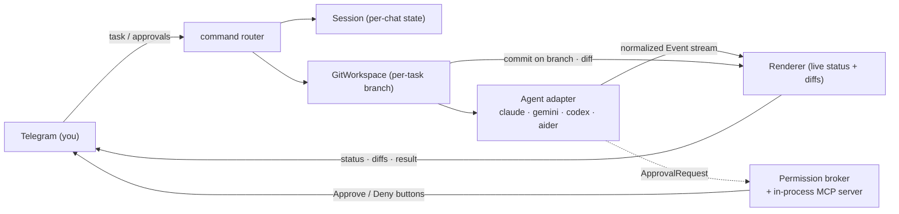

> **Languages:** [English](../en/architecture.md) · [Русский](../ru/architecture.md) · [Türkçe](../tr/architecture.md) · [Azərbaycanca](../az/architecture.md)

# Arxitektura

Bu qısa istiqamətləndirmədir. Tam dizayn kök [ARCHITECTURE.md](../../ARCHITECTURE.md) faylındadır; bu səhifə onu ümumiləşdirir və geri istinad edir.

## Pipeline

Telegram, git və session qatları **agentdən müstəqildir**: yalnız normallaşdırılmış `Event` axınını və `Agent` interfeysini istehlak edirlər. Heç bir agentə xas tip yuxarıya sızmır.

## Normallaşdırılmış hadisə modeli

Adapterlər satıcı CLI-nı bu hadisələrə çevirir:

`AssistantText`, `ToolUse`, `FileEdit{Path, UnifiedDiff}`, `Command`, `ToolResult`, `ApprovalRequest`, `Progress`, `BranchInfo`, `Committed`, `Result{Summary, Duration, CostUSD, SessionID}`, `Error`.

Zəngin agentlər (Claude) tam dəsti yayır. Zəif agentlər `AssistantText`-ə və git qatının iş sonu diff-inə enir, beləliklə `FileEdit` hadisələri olmadan da fayl dəyişiklikləri görünür.

## Paket xəritəsi

| Paket | Məsuliyyət |
|-------|-----------|
| `cmd/telepath` | Giriş nöqtəsi: konfiqurasiya, registry bağlantıları, zərif dayandırma. |
| `internal/config` | Konfiqurasiyanı yükləmək/yoxlamaq (bayraqlar > mühit > .env > standart). |
| `internal/agent` | `Agent` interfeysi, `Event` tipləri, registry, exec köməkçiləri, proses ağacının öldürülməsi. |
| `internal/agent/{claude,gemini,codex,aider}` | Hər agent üçün ayrıca adapter paketi. |
| `internal/permission` | `policy` (rejim → bayraqlar), `broker` (gözləmə/həll/timeout), `mcpserver` (təsdiq aləti). |
| `internal/git` | `guard` (təhlükəsizlik nöqtəsi), `git` (oxuma əməliyyatları), `branch` (hər tapşırıq üzrə iş axını). |
| `internal/telegram` | Bot, əmrlər, callback-lər, klaviatura, renderer, throttle. |
| `internal/session` | `Store` interfeysi arxasında hər chat üzrə vəziyyət (v1-də yaddaşda). |
| `internal/logx` | Strukturlaşdırılmış loglama (slog). |

## MCP icazə serveri

İnteraktiv rejim üçün Claude ilə Telepath loopback-də (təsadüfi port) minimal **stateless Streamable-HTTP MCP server** işlədir. O, bir alət təqdim edir, `mcp__telepath__approve`, hər sorğunu broker-ə ötürür və istifadəçinin qərarını qaytarır. Yalnız POST sorğu/cavab işləyir (server tərəfindən başladılan SSE axını yoxdur); icazə-prompt axını üçün bu kifayətdir. Hər interaktiv icra üçün təzə server başlayır, belə ki, prosesllərarası IPC yoxdur və autentifikasiya səthi yoxdur. Bax: [İcazələr](permissions.md).

## Qlobal tapşırıq ardıcıllığı

Bütün chat-lar bir `PROJECTS_DIR` working tree-ni paylaşır, git branch checkout-u isə repo üzrə qlobaldır. Buna görə Telepath bütün chat-lar üzrə **eyni anda bir tapşırıq** işlədir (qlobal bir slot və hər chat üzrə bir işləyən tapşırıq). İş sahəsi məşğul olduqda gələn tapşırıq qısa "yenidən cəhd edin" cavabı alır.

## Platformalar arası

Binary-lər `exec.LookPath` ilə tapılır (Windows-da `.exe`/`PATHEXT`-i idarə edir). Agentlər öz proses qrupunda başladılır və `/cancel`-da bütöv ağac kimi öldürülür (Windows-da `taskkill /F /T`; Unix-də proses qrupu üzrə `SIGKILL`).
