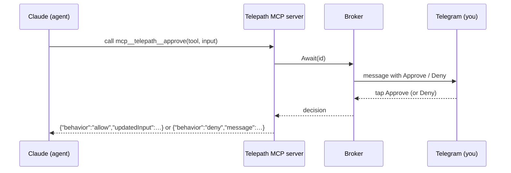

> **Languages:** [English](../en/permissions.md) · [Русский](../ru/permissions.md) · [Türkçe](../tr/permissions.md) · [Azərbaycanca](../az/permissions.md)

# İcazələr

İcazə rejimi agentin həssas hərəkətlərinin necə qapalı olduğunu idarə edir. Onu qlobal olaraq `PERMISSION_MODE` ilə, chat üzrə `/perm` ilə təyin edin; və ya tapşırıq üzrə tətbiq olunur.

## Üç rejim

### `auto` (standart)

Sorğu yoxdur; agent muxtar işləyir. Agent üzrə xəritələnmə:

- **Claude:** `--permission-mode bypassPermissions`
- **Gemini:** `--approval-mode=yolo`
- **Codex:** `--sandbox workspace-write --ask-for-approval never`
- **Aider:** `--yes` (Aider burada həmişə avtomatik təsdiq edir)

Bu ən sürətli rejimdir, lakin agent soruşmadan fayl redaktə edə və əmr icra edə bilər. Buna baxmayaraq git qoruyucusu təsir dairəsini yerli branch ilə məhdudlaşdırır — remote-unuz və ya `main`-iniz yox.

### `allowlist`

Təhlükəsiz alətlər dəsti əvvəlcədən təsdiqlənir, qalan hər şey isə interaktiv sorğu olmadan rədd edilir. Claude üçün bu `--allowedTools` / `--disallowedTools` istifadə edir. Headless rejimdə icazəsiz alət səssizcə rədd edilir və agent davam edir.

Telepath-a daxil edilmiş standart siyahılar (`internal/permission/policy.go`):

**İcazəli:**

```
Read, Edit, Write, MultiEdit, Glob, Grep, LS, NotebookEdit, TodoWrite,
Bash(git status:*), Bash(git diff:*), Bash(git log:*), Bash(git add:*),
Bash(go build:*), Bash(go test:*), Bash(go vet:*), Bash(go run:*),
Bash(npm test:*), Bash(npm run build:*), Bash(ls:*), Bash(cat:*), Bash(pwd)
```

**Rədd edilən (üstünlük təşkil edir):**

```
Bash(rm:*), Bash(git push:*), Bash(git reset:*), Bash(git checkout:*),
Bash(curl:*), Bash(wget:*), Bash(sudo:*), WebFetch
```

gemini/codex/aider üçün `allowlist` onların "həssas hərəkətlərdən əvvəl soruş" rejiminə xəritələnir (`--approval-mode=default`, `--ask-for-approval on-request` və s.).

### `interactive`

Hər nəzarət olunan hərəkəti Telegram-dan canlı təsdiq və ya rədd edirsiniz.



Telepath loopback üzərində kiçik **proses daxili MCP server** başladır və Claude-u `--permission-prompt-tool mcp__telepath__approve` ilə və onu qeydiyyatdan keçirən `--mcp-config` faylı ilə işə salır. Claude nəzarət olunan alət istədikdə MCP aləti çağırılır; Telepath **Approve / Deny** mesajı göndərir və sizin basışınızı gözləyir. Qərar Claude-a onun gözlədiyi dəqiq formada qaytarılır.

**Timeout → rədd.** Əgər `APPROVAL_TIMEOUT_SECONDS` (standart 120) ərzində cavab verməsəniz, və ya tapşırıq ləğv edilsə, sorğu **rədd edilir**. Susan istifadəçi heç nəyi avtomatik təsdiqləmir.

## Yalnız Claude, avtomatik geri düşmə ilə

İnteraktiv təsdiq yalnız Claude-un təqdim etdiyi MCP icazə hook-u tələb edir. gemini, codex və ya aider istifadə edərkən `interactive` seçsəniz, Telepath həmin tapşırıq üçün avtomatik `allowlist`-ə keçir və cavab hansı rejimin faktiki istifadə olunduğunu bildirir.

## Hansı rejimi istifadə etməliyəm?

- Etibarlı, yaxşı məhdudlaşdırılmış tapşırıqlar və sürət istəyirsinizsə → `auto`.
- Daimi nəzarət olmadan təhlükəsizlik şəbəkəsi istəyirsinizsə → `allowlist`.
- Həssas repozitori var və ya hər riskli addımı görmək istəyirsinizsə → `interactive` (Claude).
