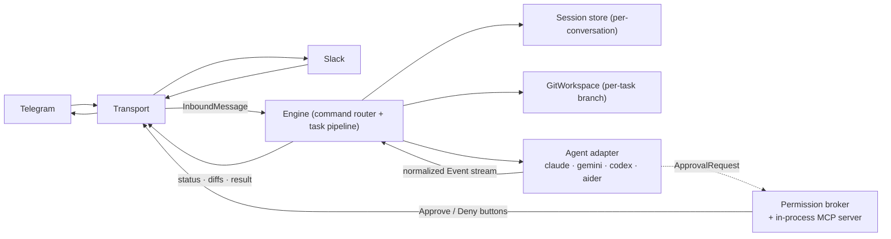

> **Languages:** [English](../en/architecture.md) · [Русский](../ru/architecture.md) · [Türkçe](../tr/architecture.md) · [Azərbaycanca](../az/architecture.md)

# Architecture

This is a short orientation. The full design lives in the root
[ARCHITECTURE.md](../../ARCHITECTURE.md); this page summarizes it and links back.

## Pipeline

## Transport abstraction

The messaging platform sits behind the `internal/transport` interface. Inbound,
a transport parses platform events into an `InboundMessage{Transport,
ConversationID, ThreadID, UserID, Text}` and hands it to the engine. Outbound,
the engine drives a per-task `Session` (status / notice / file-diff / approval /
result) built from transport-agnostic message `Doc`s; each transport renders
those in its own markup (Telegram HTML + inline keyboards, Slack mrkdwn + Block
Kit) and owns its own file-upload mechanics.

The engine, git, agent, permission, and session layers are **transport- and
agent-independent**: they consume only the `Event` stream, the `Agent`
interface, and the `Transport`/`Session` interfaces. The only state change for
multi-transport support is the session key: `transport:conversation` instead of
a bare chat id. See [Transports](transports.md).

## Normalized event model

Adapters translate a vendor CLI into these events:

`AssistantText`, `ToolUse`, `FileEdit{Path, UnifiedDiff}`, `Command`,
`ToolResult`, `ApprovalRequest`, `Progress`, `BranchInfo`, `Committed`,
`Result{Summary, Duration, CostUSD, SessionID}`, `Error`.

Rich agents (Claude) emit the full set. Poorer agents degrade to `AssistantText`
plus the git layer's end-of-run diff, so file changes still show up even without
`FileEdit` events.

## Package map

| Package | Responsibility |
|---------|----------------|
| `cmd/telepath` | Entry point: config, registry wiring, graceful shutdown. |
| `internal/config` | Load/validate config (flags > env > .env > defaults). |
| `internal/agent` | The `Agent` interface, `Event` types, registry, exec helpers, process-tree kill. |
| `internal/agent/{claude,gemini,codex,aider}` | One adapter package per agent. |
| `internal/permission` | `policy` (mode → flags), `broker` (await/resolve/timeout), `mcpserver` (approval tool). |
| `internal/git` | `guard` (the safety choke point), `git` (read ops), `branch` (per-task workflow). |
| `internal/transport` | Platform abstraction: `Transport`/`Session`/`Router` interfaces, the message `Doc` model, shared status rendering, and throttling. |
| `internal/engine` | Transport-agnostic command dispatch + task pipeline (implements `Router`). |
| `internal/telegram` | Telegram transport: long-polling, HTML rendering, inline keyboards. |
| `internal/slack` | Slack transport: Socket Mode, mrkdwn rendering, Block Kit, external file upload. |
| `internal/session` | Per-conversation state behind a `Store` interface (in-memory in v1). |
| `internal/logx` | Structured logging (slog). |

## MCP permission server

For interactive mode with Claude, Telepath hosts a minimal **stateless
Streamable-HTTP MCP server** on loopback (random port). It exposes one tool,
`mcp__telepath__approve`, which forwards each request to the broker and returns
the user's decision. It handles POST request/response only (no server-initiated
SSE stream), which is all the permission-prompt flow needs. A fresh server is
started per interactive run, so there is no cross-process IPC and no auth
surface. See [Permissions](permissions.md).

## Global task serialization

All chats share one `PROJECTS_DIR` working tree, and a git branch checkout is
global to the repo. So Telepath runs **one task at a time** across all chats,
guarded by a single global slot (plus one-running-task-per-chat). A task that
arrives while the workspace is busy gets a short "try again" reply.

## Cross-platform

Binaries are detected with `exec.LookPath` (handles `.exe`/`PATHEXT` on Windows).
Agents are spawned in their own process group and killed as a whole tree on
`/cancel` (`taskkill /F /T` on Windows; process-group `SIGKILL` on Unix).

---

<!-- prev-next -->
[← Previous: Branch workflow](./branch-workflow.md)  ·  [Next: Docker →](./docker.md)
