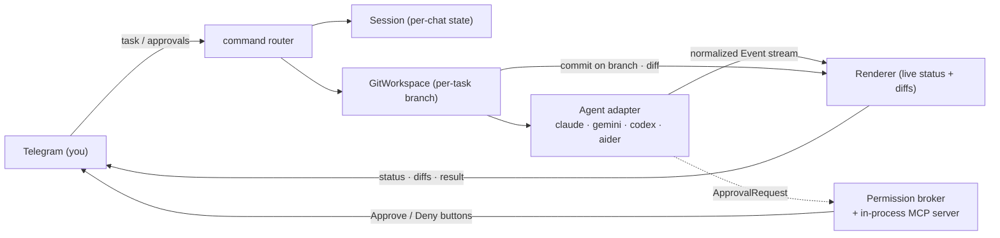

> **Languages:** [English](../en/architecture.md) · [Русский](../ru/architecture.md) · [Türkçe](../tr/architecture.md) · [Azərbaycanca](../az/architecture.md)

# Architecture

This is a short orientation. The full design lives in the root
[ARCHITECTURE.md](../../ARCHITECTURE.md); this page summarizes it and links back.

## Pipeline

The Telegram, git, and session layers are **agent-independent**: they consume
only the normalized `Event` stream and the `Agent` interface. No agent-specific
type leaks upward.

## Normalized event model

Adapters translate a vendor CLI into these events:

`AssistantText`, `ToolUse`, `FileEdit{Path, UnifiedDiff}`, `Command`,
`ToolResult`, `ApprovalRequest`, `Progress`, `BranchInfo`, `Committed`,
`Result{Summary, Duration, CostUSD, SessionID}`, `Error`.

Rich agents (Claude) emit the full set. Poorer agents degrade to `AssistantText`
plus the git layer's end-of-run diff, so file changes still show up even without
`FileEdit` events.

## Package map

| Package | Responsibility |
|---------|----------------|
| `cmd/telepath` | Entry point: config, registry wiring, graceful shutdown. |
| `internal/config` | Load/validate config (flags > env > .env > defaults). |
| `internal/agent` | The `Agent` interface, `Event` types, registry, exec helpers, process-tree kill. |
| `internal/agent/{claude,gemini,codex,aider}` | One adapter package per agent. |
| `internal/permission` | `policy` (mode → flags), `broker` (await/resolve/timeout), `mcpserver` (approval tool). |
| `internal/git` | `guard` (the safety choke point), `git` (read ops), `branch` (per-task workflow). |
| `internal/telegram` | Bot, commands, callbacks, keyboard, renderer, throttle. |
| `internal/session` | Per-chat state behind a `Store` interface (in-memory in v1). |
| `internal/logx` | Structured logging (slog). |

## MCP permission server

For interactive mode with Claude, Telepath hosts a minimal **stateless
Streamable-HTTP MCP server** on loopback (random port). It exposes one tool,
`mcp__telepath__approve`, which forwards each request to the broker and returns
the user's decision. It handles POST request/response only (no server-initiated
SSE stream), which is all the permission-prompt flow needs. A fresh server is
started per interactive run, so there is no cross-process IPC and no auth
surface. See [Permissions](permissions.md).

## Global task serialization

All chats share one `PROJECTS_DIR` working tree, and a git branch checkout is
global to the repo. So Telepath runs **one task at a time** across all chats,
guarded by a single global slot (plus one-running-task-per-chat). A task that
arrives while the workspace is busy gets a short "try again" reply.

## Cross-platform

Binaries are detected with `exec.LookPath` (handles `.exe`/`PATHEXT` on Windows).
Agents are spawned in their own process group and killed as a whole tree on
`/cancel` (`taskkill /F /T` on Windows; process-group `SIGKILL` on Unix).
