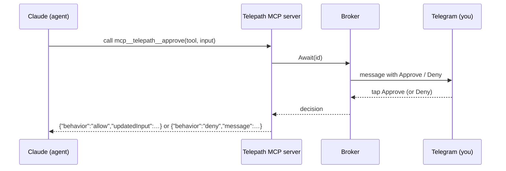

> **Languages:** [English](../en/permissions.md) · [Русский](../ru/permissions.md) · [Türkçe](../tr/permissions.md) · [Azərbaycanca](../az/permissions.md)

# Permissions

The permission mode controls how the agent's sensitive actions are gated. Set it
globally with `PERMISSION_MODE`, per chat with `/perm`, or it applies per task.

## The three modes

### `auto` (default)

No prompts; the agent runs autonomously. Mapped per agent:

- **Claude:** `--permission-mode bypassPermissions`
- **Gemini:** `--approval-mode=yolo`
- **Codex:** `--sandbox workspace-write --ask-for-approval never`
- **Aider:** `--yes` (Aider always auto-confirms here)

This is the fastest mode but the agent can edit files and run commands without
asking. Even so, the git guard keeps the blast radius to a local branch — never
your remote or `main`.

### `allowlist`

A safe tool set is pre-approved and everything else is denied, with no
interactive prompts. For Claude this uses `--allowedTools` / `--disallowedTools`.
In headless mode a disallowed tool is denied silently and the agent continues.

The defaults built into Telepath (`internal/permission/policy.go`):

**Allowed:**

```
Read, Edit, Write, MultiEdit, Glob, Grep, LS, NotebookEdit, TodoWrite,
Bash(git status:*), Bash(git diff:*), Bash(git log:*), Bash(git add:*),
Bash(go build:*), Bash(go test:*), Bash(go vet:*), Bash(go run:*),
Bash(npm test:*), Bash(npm run build:*), Bash(ls:*), Bash(cat:*), Bash(pwd)
```

**Denied (takes precedence):**

```
Bash(rm:*), Bash(git push:*), Bash(git reset:*), Bash(git checkout:*),
Bash(curl:*), Bash(wget:*), Bash(sudo:*), WebFetch
```

For gemini/codex/aider, `allowlist` maps to their "ask before sensitive actions"
mode (`--approval-mode=default`, `--ask-for-approval on-request`, etc.).

### `interactive`

You approve or deny each gated action live from Telegram.



Telepath starts a tiny **in-process MCP server** on loopback and launches Claude
with `--permission-prompt-tool mcp__telepath__approve` plus an `--mcp-config`
file that registers it. When Claude wants a gated tool, the MCP tool is called;
Telepath posts an **Approve / Deny** message and blocks on your tap. The decision
is returned to Claude in the exact shape it expects.

**Timeout → deny.** If you don't respond within `APPROVAL_TIMEOUT_SECONDS`
(default 120), or the task is cancelled, the request is **denied**. A silent user
never auto-approves anything.

## Claude-only, with automatic fallback

Interactive approval needs an MCP permission hook, which **only Claude** exposes.
If you select `interactive` while using gemini, codex, or aider, Telepath
automatically falls back to `allowlist` for that task and the reply tells you
which mode was actually used.

## Which mode should I use?

- Trusted, well-scoped tasks and you want speed → `auto`.
- You want a safety net without babysitting → `allowlist`.
- Sensitive repo or you want to see every risky step → `interactive` (Claude).
