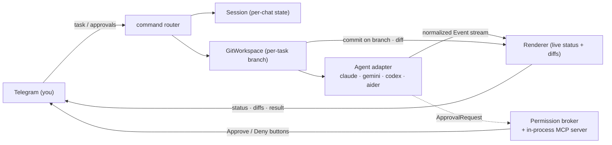

> **Languages:** [English](../en/architecture.md) · [Русский](../ru/architecture.md) · [Türkçe](../tr/architecture.md) · [Azərbaycanca](../az/architecture.md)

# Архитектура

Это краткий обзор. Полная документация по проектированию находится в корневом файле
[ARCHITECTURE.md](../../ARCHITECTURE.md); эта страница её кратко описывает и ссылается на неё.

## Конвейер

Слои Telegram, git и сессий **не зависят от агента**: они используют только нормализованный
поток `Event` и интерфейс `Agent`. Никакие типы, специфичные для агента, не поднимаются
выше.

## Модель нормализованных событий

Адаптеры переводят CLI вендора в эти события:

`AssistantText`, `ToolUse`, `FileEdit{Path, UnifiedDiff}`, `Command`,
`ToolResult`, `ApprovalRequest`, `Progress`, `BranchInfo`, `Committed`,
`Result{Summary, Duration, CostUSD, SessionID}`, `Error`.

Развитые агенты (Claude) выдают полный набор. Более простые агенты деградируют до
`AssistantText` плюс диффа в конце запуска от git-слоя, поэтому изменения файлов
всё равно отображаются даже без событий `FileEdit`.

## Карта пакетов

| Пакет | Ответственность |
|-------|-----------------|
| `cmd/telepath` | Точка входа: конфигурация, связывание реестра, корректное завершение работы. |
| `internal/config` | Загрузка и проверка конфигурации (флаги > env > .env > значения по умолчанию). |
| `internal/agent` | Интерфейс `Agent`, типы `Event`, реестр, вспомогательные функции exec, завершение дерева процессов. |
| `internal/agent/{claude,gemini,codex,aider}` | Один пакет адаптера на каждого агента. |
| `internal/permission` | `policy` (режим → флаги), `broker` (await/resolve/timeout), `mcpserver` (инструмент подтверждения). |
| `internal/git` | `guard` (главная точка защиты безопасности), `git` (операции чтения), `branch` (рабочий процесс per-task). |
| `internal/telegram` | Бот, команды, callback-и, клавиатура, рендерер, throttle. |
| `internal/session` | Состояние по чатам за интерфейсом `Store` (в памяти в v1). |
| `internal/logx` | Структурированное логирование (slog). |

## MCP-сервер разрешений

Для интерактивного режима с Claude Telepath запускает минимальный **stateless
MCP-сервер Streamable-HTTP** на loopback (случайный порт). Он предоставляет один инструмент,
`mcp__telepath__approve`, который передаёт каждый запрос брокеру и возвращает
решение пользователя. Он обрабатывает только запросы/ответы POST (без серверного SSE-потока),
чего достаточно для потока запросов разрешений. Новый сервер запускается
для каждого интерактивного запуска, поэтому нет межпроцессного IPC и нет
поверхности аутентификации. См. [Разрешения](permissions.md).

## Глобальная сериализация задач

Все чаты используют один рабочий каталог `PROJECTS_DIR`, а переключение git-веток
глобально для репозитория. Поэтому Telepath выполняет **одну задачу за раз** во всех чатах,
защищённых одним глобальным слотом (плюс одна выполняющаяся задача на чат). Задача,
которая поступает, когда рабочее пространство занято, получает короткий ответ «попробуйте снова».

## Кроссплатформенность

Бинарные файлы обнаруживаются через `exec.LookPath` (обрабатывает `.exe`/`PATHEXT` в Windows).
Агенты запускаются в собственной группе процессов и при `/cancel` убиваются целиком вместе с деревом
процессов (`taskkill /F /T` в Windows; `SIGKILL` для группы процессов в Unix).
