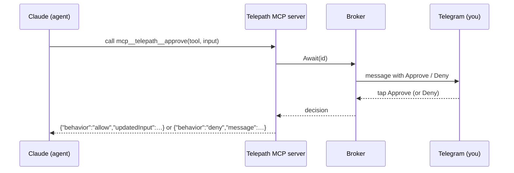

> **Languages:** [English](../en/permissions.md) · [Русский](../ru/permissions.md) · [Türkçe](../tr/permissions.md) · [Azərbaycanca](../az/permissions.md)

# Разрешения

Режим разрешений определяет, как контролируются чувствительные действия агента. Задайте его
глобально через `PERMISSION_MODE`, для каждого чата — через `/perm`; он также может
применяться для каждой задачи.

## Три режима

### `auto` (по умолчанию)

Без запросов; агент работает автономно. Сопоставление по агентам:

- **Claude:** `--permission-mode bypassPermissions`
- **Gemini:** `--approval-mode=yolo`
- **Codex:** `--sandbox workspace-write --ask-for-approval never`
- **Aider:** `--yes` (Aider здесь всегда подтверждает автоматически)

Это самый быстрый режим, но агент может редактировать файлы и запускать команды
без вопросов. Даже так защитный механизм git ограничивает последствия локальной веткой —
никогда не удалённым репозиторием или `main`.

### `allowlist`

Безопасный набор инструментов предварительно разрешён, всё остальное запрещено, без
интерактивных запросов. Для Claude используются `--allowedTools` / `--disallowedTools`.
В headless-режиме запрещённый инструмент молча отклоняется, и агент продолжает работу.

Значения по умолчанию, встроенные в Telepath (`internal/permission/policy.go`):

**Разрешено:**

```
Read, Edit, Write, MultiEdit, Glob, Grep, LS, NotebookEdit, TodoWrite,
Bash(git status:*), Bash(git diff:*), Bash(git log:*), Bash(git add:*),
Bash(go build:*), Bash(go test:*), Bash(go vet:*), Bash(go run:*),
Bash(npm test:*), Bash(npm run build:*), Bash(ls:*), Bash(cat:*), Bash(pwd)
```

**Запрещено (имеет приоритет):**

```
Bash(rm:*), Bash(git push:*), Bash(git reset:*), Bash(git checkout:*),
Bash(curl:*), Bash(wget:*), Bash(sudo:*), WebFetch
```

Для gemini/codex/aider `allowlist` соответствует их режиму «спрашивать перед чувствительными
действиями» (`--approval-mode=default`, `--ask-for-approval on-request` и т. д.).

### `interactive`

Вы подтверждаете или отклоняете каждое контролируемое действие в реальном времени из Telegram.



Telepath запускает крошечный **внутрипроцессный MCP-сервер** на loopback и запускает Claude
с `--permission-prompt-tool mcp__telepath__approve` и файлом `--mcp-config`, который
регистрирует его. Когда Claude хочет выполнить контролируемый инструмент, вызывается MCP-инструмент;
Telepath отправляет сообщение **Approve / Deny** и блокируется до вашего нажатия. Решение
возвращается Claude в точно том формате, который он ожидает.

**Таймаут → отказ.** Если вы не ответите в течение `APPROVAL_TIMEOUT_SECONDS`
(по умолчанию 120), либо задача отменена, запрос **отклоняется**. Молчащий пользователь
никогда не одобряет ничего автоматически.

## Только для Claude, с автоматическим откатом

Интерактивное подтверждение требует хука разрешений MCP, который предоставляет **только Claude**.
Если вы выбираете `interactive` при использовании gemini, codex или aider, Telepath
автоматически переключается на `allowlist` для этой задачи, а ответ сообщает,
какой режим был фактически использован.

## Какой режим выбрать?

- Доверенные, хорошо ограниченные задачи, и нужна скорость → `auto`.
- Нужна страховка без постоянного присмотра → `allowlist`.
- Чувствительный репозиторий или нужно видеть каждый рискованный шаг → `interactive` (Claude).

---

<!-- prev-next -->
[← Назад: Агенты](./agents.md)  ·  [Вперёд: Работа с ветками →](./branch-workflow.md)
