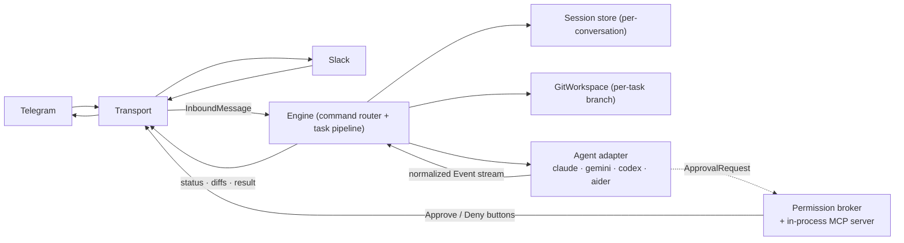

> **Languages:** [English](../en/architecture.md) · [Русский](../ru/architecture.md) · [Türkçe](../tr/architecture.md) · [Azərbaycanca](../az/architecture.md)

# Mimari

Bu kısa bir yönlendirmedir. Tam tasarım kök dizindeki [ARCHITECTURE.md](../../ARCHITECTURE.md) dosyasında yer alır; bu sayfa özetler ve oraya geri bağlanır.

## Pipeline

## Transport abstraction

Mesajlaşma platformu `internal/transport` arayüzünün arkasında yer alır. Gelen
mesajlarda bir transport, platform olaylarını bir `InboundMessage{Transport,
ConversationID, ThreadID, UserID, Text}` yapısına ayrıştırır ve motora iletir.
Giden mesajlarda motor, taşımadan bağımsız mesaj `Doc`'larından oluşturulan
görev başına bir `Session` (durum / bildirim / dosya diff'i / onay / sonuç)
yönetir; her transport bunları kendi işaretleme diliyle render eder (Telegram
HTML + satır içi klavyeler, Slack mrkdwn + Block Kit) ve kendi dosya yükleme
mekanizmasını yönetir.

Motor, git, ajan, izin ve oturum katmanları **transport'tan ve ajandan
bağımsızdır**: yalnızca `Event` akışını, `Agent` arayüzünü ve `Transport`/`Session`
arayüzlerini kullanırlar. Çoklu transport desteği için tek durum değişikliği
oturum anahtarıdır: çıplak bir sohbet kimliği yerine `transport:conversation`.
Bkz. [Transport'lar](transports.md).

## Normalleştirilmiş olay modeli

Adaptörler bir satıcı CLI'sini şu olaylara çevirir:

`AssistantText`, `ToolUse`, `FileEdit{Path, UnifiedDiff}`, `Command`, `ToolResult`, `ApprovalRequest`, `Progress`, `BranchInfo`, `Committed`, `Result{Summary, Duration, CostUSD, SessionID}`, `Error`.

Zengin ajanlar (Claude) tam seti üretir. Daha sade ajanlar `AssistantText` üretir ve git katmanının çalışma sonu diff'ine geri düşer; böylece `FileEdit` olayları olmadan bile dosya değişiklikleri görünür.

## Paket haritası

| Paket | Sorumluluk |
|-------|------------|
| `cmd/telepath` | Giriş noktası: yapılandırma, kayıt defteri bağlantısı, zarif kapanış. |
| `internal/config` | Yapılandırmayı yükleme ve doğrulama (bayraklar > ortam > .env > varsayılanlar). |
| `internal/agent` | `Agent` arayüzü, `Event` türleri, kayıt defteri, exec yardımcıları, süreç ağacını sonlandırma. |
| `internal/agent/{claude,gemini,codex,aider}` | Ajan başına bir adaptör paketi. |
| `internal/permission` | `policy` (mod → bayraklar), `broker` (bekle/çöz/zaman aşımı), `mcpserver` (onay aracı). |
| `internal/git` | `guard` (güvenlik darboğazı), `git` (okuma işlemleri), `branch` (görev başına iş akışı). |
| `internal/transport` | Platform soyutlaması: `Transport`/`Session`/`Router` arayüzleri, mesaj `Doc` modeli, ortak durum render'ı ve throttle. |
| `internal/engine` | Transport'tan bağımsız komut yönlendirme + görev pipeline'ı (`Router`'ı uygular). |
| `internal/telegram` | Telegram transport'u: long-polling, HTML render, satır içi klavyeler. |
| `internal/slack` | Slack transport'u: Socket Mode, mrkdwn render, Block Kit, harici dosya yükleme. |
| `internal/session` | `Store` arayüzü arkasında sohbet başına durum (v1'de bellek içi). |
| `internal/logx` | Yapılandırılmış günlükleme (slog). |

## MCP izin sunucusu

Claude ile etkileşimli mod için Telepath, loopback üzerinde (rastgele bir port) minimal, **durumsuz bir Streamable-HTTP MCP sunucusu** barındırır. Tek bir araç sunar, `mcp__telepath__approve`; her isteği broker'a iletir ve kullanıcının kararını geri döndürür. Yalnızca POST istek/yanıt işler (sunucu tarafından başlatılan SSE akışı yoktur); izin-istemi akışının ihtiyacı olan tek şey budur. Etkileşimli her çalıştırma için yeni bir sunucu başlatılır; böylece süreçler arası IPC yoktur ve kimlik doğrulama yüzeyi de yoktur. Bkz. [İzinler](permissions.md).

## Genel görev sıralaması

Tüm sohbetler tek bir `PROJECTS_DIR` çalışma ağacını paylaşır ve bir git branch checkout'u depo genelindedir. Bu nedenle Telepath, tüm sohbetler genelinde **aynı anda tek bir görev** çalıştırır; bunu tek bir genel slot (artı sohbet başına bir çalışan görev kuralı) korur. Çalışma alanı meşgulken gelen bir görev kısa bir "tekrar deneyin" yanıtı alır.

## Platformlar arası

İkili dosyalar `exec.LookPath` ile tespit edilir (Windows'ta `.exe`/`PATHEXT` ile). Ajanlar kendi süreç grubunda başlatılır ve `/cancel` komutunda tüm ağaç olarak sonlandırılır (Windows'ta `taskkill /F /T`; Unix'te süreç grubu `SIGKILL`).

---

<!-- prev-next -->
[← Önceki: Dal iş akışı](./branch-workflow.md)  ·  [Sonraki: Docker →](./docker.md)
