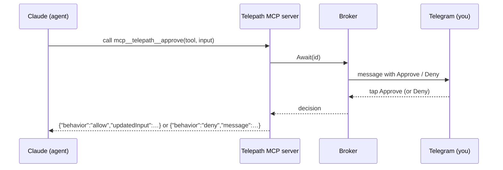

> **Languages:** [English](../en/permissions.md) · [Русский](../ru/permissions.md) · [Türkçe](../tr/permissions.md) · [Azərbaycanca](../az/permissions.md)

# İzinler

İzin modu, ajanın hassas eylemlerinin nasıl kontrol edileceğini belirler. Genel olarak `PERMISSION_MODE` ile, sohbet bazında `/perm` ile ayarlayabilir veya her göreve özel olarak uygulayabilirsiniz.

## Üç mod

### `auto` (varsayılan)

İstem yoktur; ajan özerk olarak çalışır. Ajana göre eşleme şöyledir:

- **Claude:** `--permission-mode bypassPermissions`
- **Gemini:** `--approval-mode=yolo`
- **Codex:** `--sandbox workspace-write --ask-for-approval never`
- **Aider:** `--yes` (Aider burada her zaman otomatik onaylar)

Bu en hızlı moddur, ancak ajan sormadan dosya düzenleyebilir ve komut çalıştırabilir. Buna rağmen git koruması, etki alanını yerel bir branch ile sınırlar — uzak depoya veya `main`'e asla dokunmaz.

### `allowlist`

Güvenli bir araç kümesi önceden onaylanır, geri kalan her şey reddedilir; etkileşimli istem yoktur. Claude için bu, `--allowedTools` / `--disallowedTools` kullanır. Başsız (headless) modda izin verilmeyen bir araç sessizce reddedilir ve ajan devam eder.

Telepath'in yerleşik varsayılanları (`internal/permission/policy.go`):

**İzin verilenler:**

```
Read, Edit, Write, MultiEdit, Glob, Grep, LS, NotebookEdit, TodoWrite,
Bash(git status:*), Bash(git diff:*), Bash(git log:*), Bash(git add:*),
Bash(go build:*), Bash(go test:*), Bash(go vet:*), Bash(go run:*),
Bash(npm test:*), Bash(npm run build:*), Bash(ls:*), Bash(cat:*), Bash(pwd)
```

**Reddedilenler (öncelikli):**

```
Bash(rm:*), Bash(git push:*), Bash(git reset:*), Bash(git checkout:*),
Bash(curl:*), Bash(wget:*), Bash(sudo:*), WebFetch
```

gemini/codex/aider için `allowlist`, bunların "hassas eylemlerden önce sor" moduna eşlenir (`--approval-mode=default`, `--ask-for-approval on-request` vb.).

### `interactive`

Her kontrol edilen eylemi Telegram'dan canlı olarak siz onaylar veya reddedersiniz.



Telepath, loopback üzerinde küçük bir **süreç içi MCP sunucusu** başlatır ve Claude'u, bu sunucuyu kaydeden bir `--mcp-config` dosyasıyla birlikte `--permission-prompt-tool mcp__telepath__approve` bayrağıyla çalıştırır. Claude kontrol edilen bir araç istediğinde MCP aracı çağrılır; Telepath bir **Approve / Deny** mesajı gönderir ve siz dokunana kadar bekler. Karar, Claude'un beklediği tam biçimde ona geri döndürülür.

**Zaman aşımı → reddet.** `APPROVAL_TIMEOUT_SECONDS` süresi (varsayılan 120) içinde yanıt vermezseniz veya görev iptal edilirse istek **reddedilir**. Sessiz bir kullanıcı hiçbir şeyi otomatik olarak onaylamaz.

## Yalnızca Claude, otomatik geri dönüşle

Etkileşimli onay bir MCP izin kancası gerektirir ve bunu **yalnızca Claude** sunar. gemini, codex veya aider kullanırken `interactive` seçerseniz, Telepath o görev için otomatik olarak `allowlist`'e geri döner ve yanıt, gerçekte hangi modun kullanıldığını bildirir.

## Hangi modu kullanmalıyım?

- Güvenilir, iyi kapsamlı görevler ve hız istiyorsanız → `auto`.
- Sürekli ilgilenmeden bir güvenlik ağı istiyorsanız → `allowlist`.
- Hassas bir depoyla çalışıyorsanız veya her riskli adımı görmek istiyorsanız → `interactive` (Claude).

---

<!-- prev-next -->
[← Önceki: Ajanlar](./agents.md)  ·  [Sonraki: Dal iş akışı →](./branch-workflow.md)
